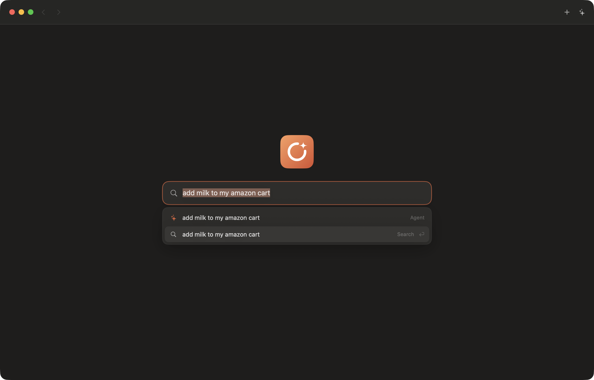

# Browser

A simple, fast web browser for the agentic world. One bar does everything: go to a site, search, or tell the built-in agent what you want done.



## What it does

- **One bar.** Type an address, a search, or a request. The browser works out which and lets you switch with the arrow keys.
- **Your own agent.** The agent reads the page as text and acts in the tab you gave it. Point it at a model running on your Mac or at any service that uses the standard chat format.
- **Built for safety.** The agent treats website text as content, never as instructions. It never types passwords or card details, and it stops for your OK before it buys, sends, posts or deletes anything.
- **Small and quick.** It uses WebKit, the engine already on your Mac, so the app is tiny and opens instantly. Sign-ins persist like in any browser.

## Install

Download `Browser.zip` from the [latest release](../../releases/latest), unzip it, and move `Browser.app` to Applications. Requires macOS 14 or later.

This early build is signed but not yet notarized, so the first time you open it, right-click the app and choose Open.

## Build it yourself

You need Xcode. Then:

```bash
./scripts/make-app.sh
open build/Browser.app
```

## Status

Early. macOS works today. iPhone and iPad share the same core and are next. Passkey sign-in is waiting on Apple's approval for browsers.

## License

MIT. See [LICENSE](LICENSE).
